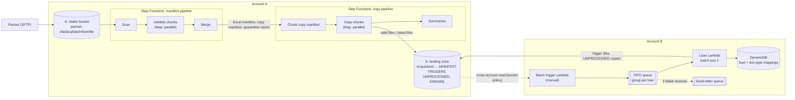

# Serverless Document Transfer Pipeline across Two AWS Accounts (demo)

[](https://github.com/Mbeng-Robert/serverless-file-transfer-demo/actions/workflows/tests.yml)

A working reference implementation of a pattern I built in production-style work: a
partner uploads loan documents over SFTP, the documents are **validated**, **copied** into a
landing zone, and handed across to a **second AWS account** that turns each loan into a
**trigger file** for a downstream loader.

Everything here is written from scratch with **made-up sample data and generic names**.
It contains no real company code, bucket names, account ids or data.

## The flow

| # | Step | Where | What happens |
| --- | --- | --- | --- |
| 1 | **Intake** | Account A | The partner uploads over SFTP into the intake bucket: `partner-sftp/<acquisition>/<batch>/<loan>/<file>`. Files are named `<LoanNumber>_<docType>_<date>_<sequence>.pdf` or `.tif`. |
| 2 | **Manifest pipeline** (Step Functions) | Account A | Scan the batch, validate chunks in parallel, merge into an **Excel manifest**, a **copy manifest** (JSON) and a **quarantine report**. |
| 3 | **Copy pipeline** (Step Functions) | Account A | Chunk the copy manifest, copy chunks in parallel: valid files into `Acquisition/`, failed files into `Acquisition/ERRORS/`. |
| 4 | **Batch trigger** (Lambda, run by hand) | Account B | Lists the batch's loan folders in the landing zone and sends **one FIFO message per loan**. |
| 5 | **Loan processing** (Lambda, SQS batch size 1) | Account B | Maps loan and document-type numbers through DynamoDB. Unmapped documents are copied to `UNPROCESSED/`. Each mapped loan gets a **trigger file** under `TRIGGERS/<batch>/`. |



**Not included:** the last hop in the real system (a scheduled sync from the landing zone to
an on-premises file share) and the SFTP server itself. Both need infrastructure that cannot be
made generic in a demo. `scripts/make_sample_data.py` plays the part of the SFTP upload.

## What the validation checks

Per file, in the manifest pipeline:

| Check | Failure reason |
| --- | --- |
| Extension is `pdf` or `tif` | `bad_extension` |
| Name matches `LoanNumber_docType_date_sequence.ext` and the date is a real date | `bad_filename` |
| Loan number in the name equals the loan folder | `loan_folder_mismatch` |
| Same loan/docType/date/sequence seen twice in the batch (first one kept) | `duplicate` |
| Malware scan tag is `THREATS_FOUND` | `malware_threat` |
| File sits exactly one folder below the batch | `unexpected_folder_depth` |

Only `THREATS_FOUND` blocks a file. Files tagged `NOT_SCANNED`, `UNKNOWN` or **not tagged at all**
still pass, because a scanner tags objects asynchronously. They are counted in the manifest
summary (`valid_but_unverified_scan`) so the gap is visible. In production you may prefer to wait
for the scan result before copying.

## Design decisions (and the problems behind them)

| Decision | Why |
| --- | --- |
| **Manifest first, then copy** | The copy step only does what a reviewed manifest says. A manifest can be inspected (or re-run) before a single file moves. |
| **Two state machines, started separately** | Each is simple, can be re-run on its own, and a human can look at the manifest in between. The copy run takes `manifest_run_id` as input. |
| **Copy, never move** | The intake bucket is never modified, so a failed run can be repeated, and no role needs `s3:DeleteObject`. |
| **`TaggingDirective="REPLACE"`** | A default `CopyObject` copies the source tags, which needs `GetObjectTagging` on the source and `PutObjectTagging` on the destination. Missing permissions then make **every copy fail with AccessDenied**. Replacing the tags removes the dependency (a test proves tags are not copied). |
| **`s3:ListBucket` on the intake bucket** | Without it S3 answers `403` for a missing object instead of `404`, which hides the real problem. |
| **Chunk files live in S3, not in the workflow payload** | Step Functions payloads are limited to 256 KB; a batch can hold hundreds of thousands of keys. Only the short list of chunk keys travels through the workflow. |
| **Skip keys ending in `/`** | SFTP `mkdir` creates a zero-byte object per folder. They are not files. They are counted separately so the numbers reconcile. |
| **Copy / missing / denied / failed are separate results** | One bad file does not fail a whole chunk, and permanent problems are not retried forever. |
| **Only throttling raises `TransientS3Error`** | Step Functions retries that error with exponential backoff and **full jitter**. Copying is idempotent, so repeating a chunk is safe. |
| **Run-scoped work folder (`work/<acq>/<batch>/<run>/`)** | Re-running never mixes old and new results. A lifecycle rule deletes it after 7 days. |
| **Reserved folder names** | An acquisition called `ERRORS` or `TRIGGERS` would collide with pipeline folders, so such names are rejected. |
| **FIFO queue with one message group per loan, batch size 1** | A loan is never processed twice at once, and one slow loan does not block others. Visibility timeout (1000 s) is longer than the Lambda timeout (300 s). A dead-letter queue catches a loan after 3 failed receives. |
| **Cross-account access via a bucket policy that names the two Account B roles** | Account B can list/read `Acquisition/*` and write only `TRIGGERS/*` and `UNPROCESSED/*`. The role policy and the bucket policy must both allow an action. |
| **Least-privilege IAM, one role per Lambda** | Each function touches only the prefixes it needs. |

### The reconciliation idea

Before a run, `scripts/pre_run_checks.sh` counts the batch (read-only):

```
all objects  =  folder markers  +  zero-byte real files  +  non-zero files
real files   =  all objects  -  folder markers
```

After the pipelines, `scripts/reconcile.py` proves:

```
intake files        = valid + failed
landing copies      = valid
ERRORS copies       = failed
```

## Repository layout

```
src/demo_pipeline/   Lambda code
                       Account A: scan_batch, validate_chunk, merge_manifest,
                                  copy_chunker (+ summary), copy_files
                       Account B: batch_trigger, loan_processor
statemachine/        The two Step Functions definitions (Terraform templates)
terraform/           Root module + modules/account_a + modules/account_b
scripts/             make_sample_data.py, seed_mappings.py, pre_run_checks.sh,
                     reconcile.py, build_layer.sh
tests/               pytest + moto (no AWS account needed)
```

## Run the tests (no AWS account needed)

```bash
python -m venv .venv && source .venv/bin/activate
pip install -r requirements-dev.txt
pytest
```

The tests fake S3, SQS and DynamoDB with [moto](https://github.com/getmoto/moto). They cover every
validation rule, the copy outcomes (copied, quarantined, missing, denied, throttled, over 5 GiB), tag
handling, idempotent re-runs, both state machine definitions, the batch trigger and loan processor,
and one end-to-end test from intake to trigger files.

## Deploy to a sandbox AWS account

Needs Terraform >= 1.5, the AWS CLI, Python 3 and credentials for a **sandbox** account.

By default **Account B is created in the same AWS account** with its own roles, so cross-account
permissions are exercised without a second account. To use a real second account, set
`account_b_profile` to its CLI profile.

```bash
scripts/build_layer.sh          # openpyxl layer used by the merge function
cd terraform
terraform init
terraform apply

export INTAKE=$(terraform output -raw intake_bucket)
export LANDING=$(terraform output -raw landing_bucket)

# 1. Fake partner upload (4 deliberately bad files are included) and mappings
python ../scripts/make_sample_data.py --bucket "$INTAKE" --loans 10
python ../scripts/seed_mappings.py --loan-table "$(terraform output -raw loan_mapping_table)" \
    --doctype-table "$(terraform output -raw doctype_mapping_table)" --loans 10

# 2. Count the batch before running
INTAKE_BUCKET="$INTAKE" ../scripts/pre_run_checks.sh ACQ01 BATCH001

# 3. Manifest pipeline (the execution name becomes the run id)
aws stepfunctions start-execution --name manifest-001 \
  --state-machine-arn "$(terraform output -raw manifest_state_machine_arn)" \
  --input '{"acquisition":"ACQ01","batch":"BATCH001"}'

# 4. Copy pipeline, once the manifest run succeeded
aws stepfunctions start-execution --name copy-001 \
  --state-machine-arn "$(terraform output -raw copy_state_machine_arn)" \
  --input '{"acquisition":"ACQ01","batch":"BATCH001","manifest_run_id":"manifest-001"}'

# 5. Prove nothing was lost
python ../scripts/reconcile.py --intake-bucket "$INTAKE" --landing-bucket "$LANDING" \
    --acquisition ACQ01 --batch BATCH001 --manifest-run-id manifest-001

# 6. Account B: queue one message per loan (loans 100004 and 100009 are unmapped on purpose)
aws lambda invoke --function-name "$(terraform output -raw batch_trigger_function)" \
    --payload '{"acquisition":"ACQ01","batch":"BATCH001"}' --cli-binary-format raw-in-base64-out out.json
aws s3 ls "s3://$LANDING/Acquisition/TRIGGERS/BATCH001/"
aws s3 ls "s3://$LANDING/Acquisition/UNPROCESSED/" --recursive
```

### Clean up

```bash
aws s3 rm "s3://$INTAKE" --recursive
aws s3 rm "s3://$LANDING" --recursive
terraform destroy
```

With these sample sizes the cost is cents.

## Honest status and limits

- **Tests pass, Terraform is unvalidated by me.** The Python and the state machine definitions are
  tested. The Terraform was only parsed, not applied; `terraform validate` runs in CI. Expect to fix
  small things on a first `apply`.
- **Objects over 5 GiB** are flagged, not copied (`CopyObject` limit; larger needs multipart copy).
- **Duplicate detection** holds the whole batch in memory in the scan Lambda; for millions of files use
  a different approach (for example a sort in Athena or a Distributed Map).
- **FIFO de-duplication** only covers a 5-minute window; re-triggering a batch later re-processes
  loans. The loan step is idempotent (trigger files are overwritten), so this is safe.
- **Encryption:** SSE-S3 here. With a customer-managed KMS key add `kms:Decrypt`/`kms:GenerateDataKey`
  to the roles and let Account B use the key (key policy or grant).
- **Alerting:** not included. In production add alarms on failed executions, the dead-letter queue
  depth and `clean = false`.
- **Scheduling:** both pipelines are started by hand on purpose. Nothing starts automatically.

## License

MIT. See [LICENSE](LICENSE).
